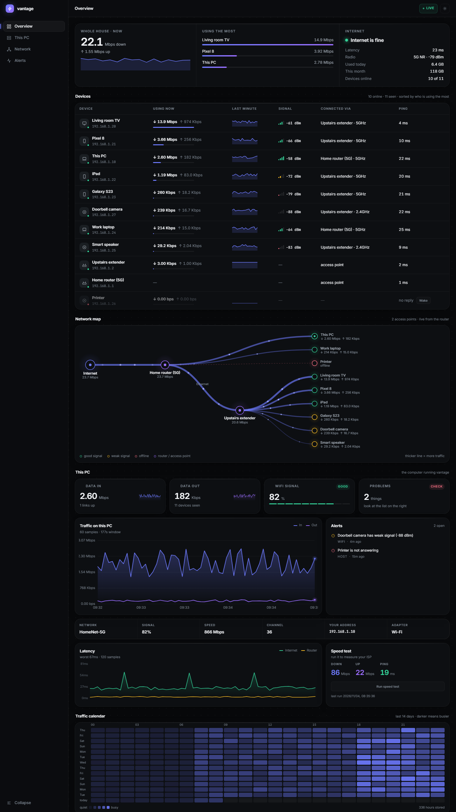

# vantage

**A host-based network observability agent.**

Reads real interface counters, discovers every device on the LAN, tracks latency and live TCP connections, pulls whole-house data usage straight from the router, and stores 30 days of history in SQLite. No switch, no cloud, no install — runs on Node.



*Screenshot uses sample data. No real device names, IPs or MACs.*

---

## Why this exists

Most network monitoring needs a managed switch and a server. vantage runs on one laptop and tells you what your network is actually doing. It was built to answer three questions:

1. *Why is my internet slow right now?*
2. *What is every device on my WiFi, and is it alive?*
3. *How much data is the whole house using?*

The third one required reverse-engineering a locked vendor router API. That is the interesting part.

---

## What it captures

| Source | What | How |
|---|---|---|
| This PC | Bytes in/out, errors, link speed, utilisation | Windows adapter statistics (real counters) |
| WiFi | SSID, signal, channel, radio type, rates | `netsh` |
| LAN devices | IP, MAC, vendor (OUI), reachability, RTT | ARP + broadcast sweep + ICMP |
| Live connections | Remote host, port, owning process | `Get-NetTCPConnection` |
| Router (whole house) | Total data used today and this month, signal, radio | Reverse-engineered ubus API |
| Router (every device) | Live upload/download per device, name, which mesh node and band, WiFi signal (dBm) | `net.info`, `web_api.get_routers`, `get_topology` over ubus |
| History | 30 days of samples, latency, speed tests | SQLite, zero dependencies |
| Alerts | Offline devices, weak WiFi, hot links | Toast + rules in `config.json` |

---

## The router reverse-engineering

The router is a **JT 4G/5G CPE** (South African ISP *rain*). Its web UI is a Vue app that talks to a locked JSON-RPC endpoint.

Three traps, in order:

1. **Every endpoint 403s unless you add `?flag=<method>&t=<ms>`** to the URL.
2. **The password is never sent in plaintext.** The UI hashes it as `sha256(salt + ":" + password)` with a random 64-character salt, then sends `{ username, password: hash, salt }`.
3. **The ubus session token is `sessionid`, not `token`.** They look identical. Only one is accepted.

Once past those three, the router exposes `cell.traffic/get_traffic_cfg` (total bytes used by every device combined) and `jytl_api/get_status_info` (5G signal, radio type, WAN status).

The firmware's own minified JavaScript (`/assets/index-*.js`) was the documentation.

---

## A real finding, from my own network

vantage measured the 5G link and reported:

```
Band           n78 (3.5 GHz C-band)
Signal         -84 dBm        ← decent
SINR           24.5 dB        ← excellent, no interference
Channel width  40 MHz         ← only 40% of available
Carrier agg.   none           ← single carrier
```

Download was 28 Mbps. The signal was fine. The bottleneck was **bandwidth allocation** — a 40 MHz slice of n78 and no carrier aggregation. The fix is upstream (plan tier / carrier aggregation), not in the house. The tool turned a guess into a measurement.

---

## Run it

```powershell
cd vantage
npm install   # nothing to install — Node 24 ships SQLite
node agent.mjs
```

Open `http://localhost:8123`.

### Make it automatic (Windows)

```powershell
powershell -ExecutionPolicy Bypass -File install-service.ps1
```

Run once. It asks for the router password (saved to `config.local.json`, which is gitignored), starts the agent hidden at every login (restarting it if it crashes, on battery too), and adds a **vantage** shortcut to the Desktop and Start menu. The shortcut opens the dashboard and starts the agent first if it isn't running.

### Configure

Edit `config.json`:

```json
{
  "agent": { "port": 8123, "pollSeconds": 3, "scanSeconds": 15, "latencySeconds": 5 },
  "router": { "enabled": true, "ip": "192.168.0.1", "user": "admin", "pass": "" },
  "retention": { "rawHours": 48, "hourlyDays": 365, "eventDays": 90 },
  "alerts": { "wifiSignalBelow": 45, "linkUtilAbove": 85, "deviceOffline": true, "toasts": true }
}
```

Or use environment variables: `VANTAGE_ROUTER_PASS`, `VANTAGE_HTTP_ADDR`, `VANTAGE_DATABASE_URL` (for the Postgres version).

---

## Architecture

```
┌────────────┐    ┌─────────────┐    ┌────────────┐    ┌────────────┐
│  collector │───▶│   SQLite    │───▶│  HTTP API  │───▶│  dashboard │
│  (Node)    │    │  (30 days)  │    │  (Node)    │    │  (vanilla) │
└────────────┘    └─────────────┘    └────────────┘    └────────────┘
      │
      ├─ Windows adapter counters
      ├─ ARP + broadcast sweep
      ├─ ICMP reachability
      ├─ Get-NetTCPConnection
      └─ router ubus API
```

The companion `vantage` Go project (separate repo, in progress) is the production version: TimescaleDB, Go collector, React UI. This repo is the working prototype that proved the approach.

---

## Security note

Credentials live in `config.json` or environment variables. There is no auth on the HTTP API — this is a single-host tool, not a multi-tenant service. Do not expose port 8123 to the internet.

---

## Requirements

- Windows 10 or 11 (the agent uses `powershell.exe` and Windows netsh)
- Node 24 or newer (uses built-in SQLite)
- A router that speaks UPnP or the JT ubus API (optional — the tool works fully without one)

---

## License

MIT
